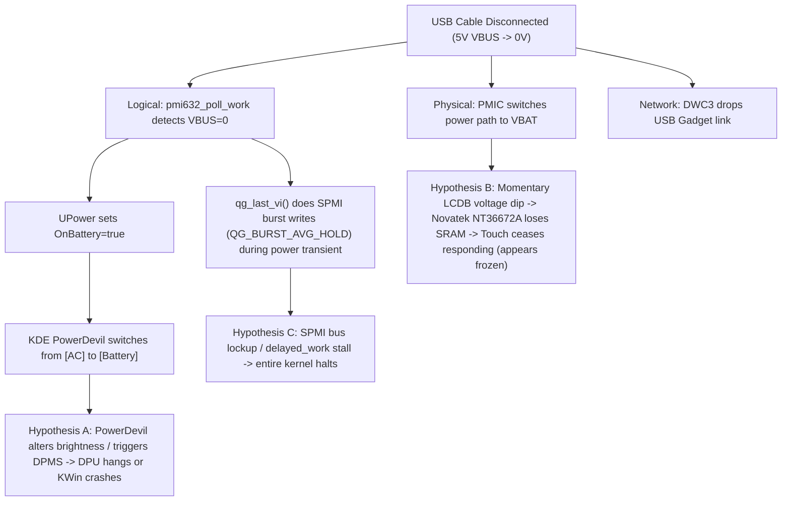

# Ginkgo Mainline Linux: Comprehensive Agent Handoff Document

> **Target Device**: Xiaomi Redmi Note 8 (codename `ginkgo`, SoC: Qualcomm SM6125 / Snapdragon 665 / Trinket)
> **Environment**: Mainline Linux 7.0 (`#142 SMP PREEMPT`), Ubuntu 26.04 LTS arm64 (`resolute`), KDE Plasma 6 Wayland desktop
> **Repository Path**: `C:\Users\User\Documents\GitHub\ginkgo-mainline-linux`
> **Date**: November 15, 2026
> **Primary References**: [AGENTS.md](../../AGENTS.md), [docs/known-issues.md](../known-issues.md), [docs/flash-guide.md](../flash-guide.md)

---

## Investigation update (November 15, 2026)

**Current recovery works:** disabling the experimental audio loader and ADSP
in `out/boot-audio-recovery.img` restored responsiveness, confirmed by the
owner after direct fastboot boot. See [audio recovery deployment](audio-recovery-deployment.md).
Audio is disabled; unplug stability and normal power-cycle boot are unverified.
The historical failed experiments below must not be mistaken for current state.

**Rollback test failed:** after restoring the pre-charging battery driver, the
owner reports another freeze during the requested unplug test. Wi-Fi SSH at the
previously observed address also timed out. Percentage reporting was restored,
but unplug stability was not. Rolling back the module alone is insufficient;
do not claim this identifies or clears the driver as the cause. The boot image
still preserves the kernel/DTB/other ramdisk contents of the more recent image,
not a verified complete image from before the regression.

**Rollback installed:** `out/boot-qg-rollback.img` was flashed successfully.
Post-reboot SSH confirmed the pre-charging driver probe message, only
`qcom-battery` (no `qcom-usb`), capacity 74%, and module SHA256
`0e9561636df5058bf734d37536871c5804d24d1aa446a002468b9cc0be8774b7`.
The rootfs/ramdisk module staging slots also contain the rollback. The tracked
driver source still contains the experimental rewrite; do not rebuild it and
mistake it for the installed baseline. Unplug behavior remains untested.
The preparation notes below predate this installation.

**Latest result:** the owner reports the rewritten driver still freezes on
unplug and confirms that percentage reporting and unplugging worked before the
charging-detection additions. Treat the current implementation as a regression,
not a verified replacement. A rollback image is prepared at
`out/boot-qg-rollback.img` using the repository HEAD version of the QG driver
(before charging detection), replacing only the ramdisk module and preserving
the phone's kernel/DTB/boot arguments. It has not yet been flashed; SSH is
unreachable while waiting for physical recovery. Experimental source and build
artifacts have been retained.

The owner has redirected work to implementing the driver. The unload/unplug
isolation test below is deferred. See [PMI632 driver implementation and validation](../pmi632-battery-driver.md)
for the current source, candidate module, tests, and remaining limitations.
The original remediation suggestions in section 5 are historical hypotheses,
not the specification for the new implementation.

The revised module has now been flashed in `out/boot-qg-monitor.img`, preserving
the phone's existing kernel/DTB/boot arguments. Post-boot SSH confirmed its
module hash, the new probe message, and working charging/USB telemetry. The
original boot partition backup is `out/boot-before-qg-monitor.img`. No further
unplug/freeze test has been performed. Capacity estimation is off; UPower shows
0% for the unavailable capacity, which is not an actual empty-battery reading.

- Before unplugging, SSH worked over both USB (`192.168.7.2`) and Wi-Fi (`10.220.61.7`, session-specific address). The driver reported USB online and the battery charging.
- The owner reproduced the screen freeze by unplugging USB. Subsequent Wi-Fi ping and SSH timed out as well. This argues against a touch-only failure but does **not** prove a kernel lockup: suspend, power loss, or loss of Wi-Fi remain possible.
- The previous boot's journal contained no recorded panic or SPMI timeout at the end. `/sys/fs/pstore` was empty. An abrupt freeze may prevent logging.
- Live PowerDevil settings already disabled idle dimming, display shutdown, and automatic suspend in AC, Battery, and LowBattery profiles.
- The SPMI controller source has a bounded transaction timeout. The SPMI deadlock explanation below is an unconfirmed hypothesis, and the proposed poller change is not a verified fix. Battery property queries also call `qg_last_vi()`, so removing it from the poller alone does not eliminate those reads.
- Next isolation test: recover the phone, temporarily unload `qcom_pmi632_qg` without changing the boot image, confirm both power-supply nodes disappear, then repeat unplugging while checking Wi-Fi. Reload the original module after testing; a reboot also restores the boot configuration.

---

## 1. Executive Summary & Current State

### What was just completed:
- **Implemented Battery & USB Charging Detection**:
  - Mainline Linux previously had no charger/USB power supply node (`/sys/class/power_supply/` only had `qcom-battery`), current polarity was inverted, and the phone permanently reported "Discharging" even when plugged in.
  - Modified [overlays/linux/drivers/power/supply/qcom-pmi632-qg.c](../../overlays/linux/drivers/power/supply/qcom-pmi632-qg.c) to:
    1. Register `/sys/class/power_supply/qcom-usb` (`POWER_SUPPLY_TYPE_USB`), tracking Qualcomm PMI632 USBIN real-time status register `0x1310 BIT(4)`.
    2. Read hardware charging state from PMI632 CHGR status register `0x1006` (`PMI632_CHGR_STATUS1`), mapping `TRICKLE`, `PRE`, `FAST`, `FULLON`, `TAPER` to `POWER_SUPPLY_STATUS_CHARGING`.
    3. Invert `current_now` sign (`val->intval = -ua`) to conform to Linux power supply ABI (positive = charging, negative = discharging).
    4. Added a periodic delayed worker `pmi632_poll_work` to call `power_supply_changed()` on status changes.
  - Built out-of-tree module `out/qcom-pmi632-qg.ko` in WSL (`Ubuntu-26.04`) matching vermagic `7.0.0-00001-g62f9dac57de4-dirty`.
  - Staged into ramdisk and repacked `out/boot.img` via `out/assemble-touch-image.sh`.
  - Flashed to device via fastboot and verified live over SSH:
    - `qcom-usb/online == 1`, `qcom-usb/present == 1`
    - `qcom-battery/status == Charging`, `current_now == +236969 uA`
    - UPower: `state: charging`, `on-battery: no`, `line-power online: yes`.

### What broke / Current problem:
- **Desktop Freeze on USB Disconnect**:
  - When the physical USB cable is unplugged from the phone, the desktop freezes / crashes.
  - The phone is currently disconnected or in a frozen state.

---

## 2. Hardware & Architecture Quick Reference

| Subsystem | Hardware Component | Interface / Details | Known Quirks / Rules |
|---|---|---|---|
| **SoC** | Qualcomm SM6125 (trinket) | 4× Kryo 260 Gold + 4× Silver | Hardware mitigations explicitly disabled (`mitigations=off`). **DO NOT re-enable.** |
| **PMIC (Primary)** | Qualcomm PM6125 | SPMI `pm6125@0` | Hardware RTC on `rtc@6000` (`rtc-pm8xxx.ko`). |
| **PMIC (Secondary)** | Qualcomm PMI632 | SPMI `pmi632@2` | Handles USBIN (`0x1300`), Charger (`0x1000`), Fuel Gauge (`0x4800`), LCDB regulator (`0xec00`), and GPIOs. |
| **Display Panel** | Tianma NT36672A | DSI Video-Mode (1080×2340 @ 60Hz) | DPU 5.0 cannot tolerate standard DPMS cycles without losing FIFO sync (`FIFO 0xcccc`, `dsi_err status=5`). |
| **Backlight** | Kinetic KTD3136 / KTD3137 | I2C-0 (`0x36`), HWEN = PMI632 GPIO6 | Controlled via `/sys/class/backlight/ktd3136-backlight/brightness`. |
| **Touchscreen** | Novatek NT36672A | SPI SE2 (`spi2`), IRQ 135 | **NO on-chip flash memory**. Volatile SRAM cleared if panel rails (`vsp`/`vsn`) drop. Recovered in <300ms by writing `1 > /sys/kernel/ginkgo_touch/resume` (`ginkgo_touch_sync.ko`). |
| **Network / Debug** | USB Gadget RNDIS | `4e00000.usb` (DWC3) | Phone IP: `192.168.7.2`, Host PC IP: `192.168.7.1`. Root password: `password`. Autologin user: `ginkgo` (uid 1000). |

> [!CRITICAL]
> **DO NOT REPLACE KERNEL BINARY WITH RAW UPSTREAM v7.0.**
> The baseline `#142` kernel at `out/deployed-unpack/kernel` has custom downstream DPU/DSI patches. Replacing it results in an empty black screen. Always build drivers as out-of-tree `.ko` kernel modules matching vermagic `7.0.0-00001-g62f9dac57de4-dirty`.

---

## 3. Root Cause Analysis of the Freeze on Disconnect

When the USB cable is unplugged, three distinct transitions occur simultaneously:



### Detailed Hypotheses:

1. **Hypothesis A: KDE PowerDevil DPMS / Brightness Crash**
   - When UPower reports `OnBattery=true`, KDE's `powerdevil` activates the `[Battery]` profile.
   - If PowerDevil attempts to reduce display brightness via sysfs or initiate display dimming/DPMS:
     - On SM6125 DPU 5.0, display is a video-mode DSI panel without command-mode self-refresh. Any DPMS cycle or unblank glitch desyncs pixel clocks, causing a black screen, DPU stall, or KWin Wayland crash.
   - Check: Inspect `~/.config/powerdevilrc` on the device.

2. **Hypothesis B: Touchscreen SRAM Dump (Display works, but touch is dead)**
   - The user stated: "desktop froze". Often users describe touch unresponsiveness as "desktop froze".
   - The Tianma NT36672A touchscreen controller shares power with the LCD panel via PMIC LCDB (`qpnp-lcdb@ec00`).
   - If VBUS unplug causes a brief dip on `vsp`/`vsn`, the touch controller resets and loses `novatek_ts_tianma_fw.bin` from SRAM. The desktop is still rendering, but touches do nothing.
   - Test: Write `echo 1 > /sys/kernel/ginkgo_touch/resume` to reload firmware.

3. **Hypothesis C: Driver Polling Worker SPMI Lockup**
   - In `qcom-pmi632-qg.c`, `pmi632_poll_work` runs every 2 seconds and calls `qg_last_vi()`.
   - `qg_last_vi()` calls `qg_read_ibat()`, which performs regmap writes to `QG_BURST_AVG_HOLD` (`0x42`).
   - If SPMI writes occur while the PMIC hardware state machine is transiently switching from USBIN to VBAT, SPMI bus access can time out or deadlock holding regmap locks, stalling the kernel workqueue.

---

## 4. Immediate Recovery & Diagnostic Procedures

### Step 1: Reconnecting and Booting the Device
1. Reconnect the phone to the PC with the USB cable.
2. If the screen is black or completely unresponsive, **hold the Power button for 10 seconds** until the phone vibrates and reboots.
3. On Windows host, verify the RNDIS adapter is detected:
   ```powershell
   Get-NetAdapter
   # Must see USB/RNDIS adapter. Host static IP should be 192.168.7.1/24.
   ```
4. Test connectivity:
   ```bash
   ping -n 1 192.168.7.2
   python scripts/ssh_cmd.py "uname -a"
   ```

### Step 2: Extracting the Crash Evidence
Immediately extract the system log from the previous boot (the freeze event):
```bash
# Previous boot journal (tail end where the freeze occurred)
python scripts/ssh_cmd.py "journalctl -b -1 -e --no-pager -n 200"

# Grep for DPU / DRM errors
python scripts/ssh_cmd.py "journalctl -b -1 | grep -iE 'dpu|dsi|drm|kwin|powerdevil|spmi'"

# Check current boot dmesg for driver errors
python scripts/ssh_cmd.py "dmesg | grep -iE 'pmi632|qg|touch|nvt'"
```

---

## 5. Remediation Plan

### Fix 1: Make `qcom-pmi632-qg.c` Polling Ultra-Lightweight (Prevents SPMI stalls)
In [overlays/linux/drivers/power/supply/qcom-pmi632-qg.c](../../overlays/linux/drivers/power/supply/qcom-pmi632-qg.c):
- In `pmi632_poll_work()`, do **NOT** call `qg_last_vi()`.
- Only read `PMI632_USBIN_INT_RT_STS` (`0x1310`) to check VBUS status (`BIT(4)`).
- If VBUS is not present, set status to `POWER_SUPPLY_STATUS_DISCHARGING` directly without touching CHGR or QG registers.
- Only call `power_supply_changed()` on edge transitions (`vbus != qg->last_vbus`).

Code pattern for `pmi632_poll_work`:
```c
static void pmi632_poll_work(struct work_struct *work)
{
	struct pmi632_qg *qg = container_of(work, struct pmi632_qg, poll_work.work);
	bool vbus = pmi632_is_vbus_present(qg);
	int status = vbus ? POWER_SUPPLY_STATUS_CHARGING : POWER_SUPPLY_STATUS_DISCHARGING;

	if (vbus != qg->last_vbus || status != qg->last_status) {
		qg->last_vbus = vbus;
		qg->last_status = status;
		power_supply_changed(qg->psy);
		if (qg->psy_usb)
			power_supply_changed(qg->psy_usb);
	}

	schedule_delayed_work(&qg->poll_work, msecs_to_jiffies(2000));
}
```

### Fix 2: Harden KDE PowerDevil Settings (Prevents DPMS blanking)
Ensure `/home/ginkgo/.config/powerdevilrc` has identical no-sleep, no-dim settings for `[Battery]`:
```ini
[Battery]
DimDisplayWhenIdle=false
TurnOffDisplayWhenIdle=false
iconName=battery-profile
powerButtonAction=0

[Battery][Display]
DimDisplayWhenIdle=false
TurnOffDisplayWhenIdle=false
```
Also verify `/etc/environment.d/20-powerdevil.conf`:
```
POWERDEVIL_NO_DDCUTIL=1
```

### Fix 3: Automatic Touch Recovery on Cable Disconnect
If the freeze is touch SRAM dump (Hypothesis B), update `/usr/local/sbin/ginkgo-touch-monitor.sh` or create a udev rule on `subsystem=="power_supply"` to trigger:
```bash
echo 1 > /sys/kernel/ginkgo_touch/resume
```
This reloads `novatek_ts_tianma_fw.bin` into SRAM within 300 ms.

---

## 6. Build, Repack & Flash Recipes

All builds take place in WSL (`Ubuntu-26.04`):

```bash
# 1. Build the out-of-tree kernel module in WSL
wsl -d Ubuntu-26.04 bash -c "cd /home/user/ginkgo-build/linux && /home/user/build-qg-module.sh"

# Verify vermagic matches exactly:
# Vermagic MUST be: 7.0.0-00001-g62f9dac57de4-dirty
wsl -d Ubuntu-26.04 bash -c "modinfo /home/user/ginkgo-build/linux/qcom-pmi632-qg.ko | grep vermagic"

# 2. Copy compiled module to repo outputs and ramdisk overlay
cp out/qcom-pmi632-qg.ko rootfs-overlay/lib/modules/ginkgo-extra/qcom-pmi632-qg.ko
cp out/qcom-pmi632-qg.ko out/initramfs-staging/overlay/lib/modules/ginkgo-extra/qcom-pmi632-qg.ko

# 3. Assemble and repack boot.img (MUST run as root in WSL for loop/cpio permissions)
wsl -u root -d Ubuntu-26.04 bash /mnt/c/Users/User/Documents/GitHub/ginkgo-mainline-linux/out/assemble-touch-image.sh

# 4. Flash via fastboot
fastboot flash boot out/boot.img
fastboot reboot
```

---

## 7. Useful Diagnostic Scripts in the Repo

- `python scripts/ssh_cmd.py "<command>"`: Preferred agent helper for direct SSH commands; requires Paramiko, prints remote output, and returns the remote exit status. Defaults to USB (`192.168.7.2`); set `GINKGO_IP` to the phone's current Wi-Fi address to use Wi-Fi. Use focused commands and limit verbose logs.
- `scripts/test_conn.py`: Socket test for SSH port 22 on `192.168.7.2`.
- `out/assemble-touch-image.sh`: Repacks `out/boot.img` with updated ramdisk overlays.
- `/home/user/build-qg-module.sh` (inside WSL): Cross-compiles `qcom-pmi632-qg.c` against the configured kernel tree.
